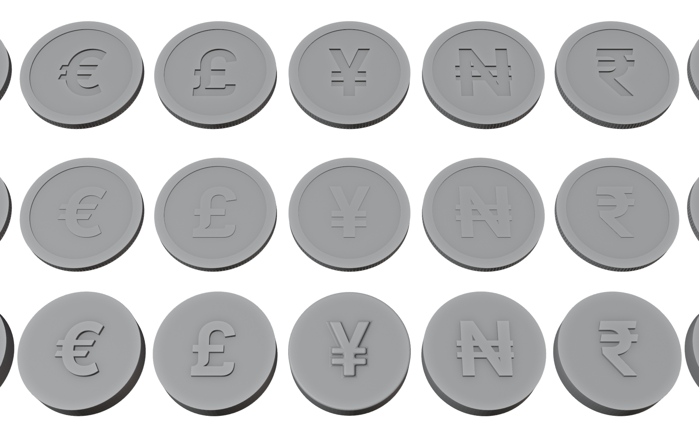

# Coin Loop

Coins modelled in **Blender**, then minted, lit and looped live in the **browser** with three.js. Every part of the look is a control: the finish (metal or stone), the light, the motion and the path the coins follow (a ring, a helix, DNA, a wave or an infinity loop). Flip to **Landing page** and the same loop becomes the hero of a real page that you style and edit like a design tool.

It was built as a hands-on design engineering project: start in Blender, finish in code, and tune it like a designer.



## Run it

You need [Node](https://nodejs.org) 20 or newer.

```bash
npm install
npm run dev        # opens http://localhost:4848
```

### The panel

- Every group folds: click its title, or use **Collapse all** at the top. The panel remembers what you left open.
- **Double-click any slider's value** to type an exact number. Typed numbers can go beyond the slider's range.
- Nothing is decided for you. Picking a shape changes only the shape, and **Suggest framing for this shape** is there when you want a starting point.

### Studio

The loop on its own: tune it, then press **Record one loop** to save an MP4 that repeats without a visible jump.

- **Move the coins:** drag them on the stage.
- **Zoom:** scroll or pinch, or use **− 100% +** on the stage bar. Hold **Option (⌥)** while scrolling to bring the coins nearer or push them back.
- **Path:** pick a shape (Ring, Market, Orbit, Cradle, Wave, Helix, DNA or Infinity), then **Suggest framing** if you want it set up for you. Market rises like a stock chart; Orbit is a flat ring seen from a low angle; Cradle is a U that frames whatever sits above it. **Twist** rolls each coin along the path like a ribbon; **Turns** and **Length** set how tightly a helix, DNA or wave coils.
- **Finish:** click a finish to make every coin that, or ⌘/Shift-click to mix several. There are six metals and four stones (granite, black granite, marble and board-formed concrete). **Symbol** sets whether the currency sign is engraved into the coin or raised from it.
- **Motion:** **Speed** slows or quickens the loop live. **Loop length** is one full cycle, and so the length of a recording.

### Landing page

The loop as the hero of a page, edited the way you'd edit a design in Figma or Framer:

- **Click** any text to select it, and **double-click** (or press Enter) to type. **Escape** or a click outside finishes.
- **Drag the side handles** of the headline or subtitle to make its lines longer or shorter.
- **Drag the empty page** to move the coins. **Pinch** to zoom, and hold **Option (⌥)** while scrolling to bring them nearer or further (a plain scroll leaves them alone). **Position** has exact X, Y, nearer/further, zoom and coin size, and **Keep clear of text** tucks them under the button.
- **Layout:** Centred (the coins under the button), Split (text left, coins right), Editorial (a big headline bottom-left, coins above it) or Card (the text on a panel, coins all around it). Switching moves the text and slides the coins into the space it leaves, without resizing them; each layout lists the paths that suit it, and **Suggest framing** sets a shape up for the layout you're in.
- **Theme:** pick a theme, or let **Auto contrast** derive every colour from the background, with button text always readable. You can also set each colour yourself: background, headline, subtitle, navigation, and the primary and secondary buttons.
- **Type and Layout:** typefaces, sizes, button shape and spacing.

## Make the coins (Blender)

The coins in `public/models/coins.glb` come from one script. Install [Blender](https://www.blender.org) 4.2 or newer, then:

```bash
npm run coins      # macOS. Elsewhere: blender -b -P blender/coins.py
```

It builds seven coins ($ € £ ¥ ₦ ₹ ₿) and writes:

- `public/models/coins.glb`: what the browser loads
- `blender/coins.blend`: open it to look around the models
- `blender/preview.png`: a quick render of the coins

Each coin goes through these steps:

1. A disc, with the field (the face inside the rim) cut a little lower than the rim.
2. A reeded edge: 120 thin grooves around the rim.
3. The symbol engraved into both faces. It is mirrored on the back so it reads correctly there. Each outline of the glyph becomes its own solid, so fonts with overlapping strokes still cut cleanly.
4. Soft bevels on every hard edge, so edges catch the light.

Every coin is built twice: once with the symbol engraved, and once with it raised in relief (`coin_USD_raised`).
5. "Cavity" shading baked into the vertex colours, darker inside the engraving. A polished engraving only reads when its recess is darker, as on a real struck coin.

Try changing `R`, `T`, `REEDS`, `ENGRAVE` or `GLYPH_H` at the top of the script, or add a currency to `COINS`.

## How it works (browser)

| File | What's in it |
|---|---|
| `src/scene.ts` | The three.js scene: loads the coins, makes the metal and stone, builds the light, lays the coins along the path each frame (`pathAt`) |
| `src/App.tsx` | The panel and the two modes |
| `src/landing.tsx` | The landing page: themes and colour tokens, selection and editing, the resizable text boxes |
| `src/controls.tsx` | The panel's rows: sliders, colours, toggles |

- **The loop.** Each coin sits at a point along a path (0 to 1) that moves forward with time. Ring and infinity are closed curves. Helix, DNA and wave run off the edges of the frame and wrap round where you can't see. Twist and spins use whole turns, so the last frame flows into the first and every loop is seamless.
- **The stone.** Granite, marble and concrete are drawn in code (concrete with formwork boards, seams and air-bubble pits): a colour map, a roughness map and a relief map, made from layered noise. The coin faces get the texture flat, like a stamp, and the rim gets it wrapped round like a label.
- **The metal.** A `MeshPhysicalMaterial` with metalness 1, plus a roughness map drawn in code (fine circular brushing and hundreds of hairline scratches) and a clear coat.
- **The light.** This is what makes silver look like silver. A polished metal has no colour of its own; it shows what it reflects. "Product strips" paints a studio into an HDR image: tall soft boxes and a curved backdrop band on black. The coins mirror black with sharp white streaks, like product photography. Switch to the photo studios in **Light** to compare.

## Things to try

- Make a coin for your own currency or logo: add it to `COINS` in `blender/coins.py`, then run `npm run coins`.
- Give each currency its own finish (gold for ₿, for example).
- Add a path shape of your own to `pathAt` in `src/scene.ts`: a spiral, a heart, a staircase.
- Add a stone to `stoneMaps`: sandstone, terrazzo, slate.
- Turn the **Speed** slider down and **Spins per loop** up, and record a slow, spinning loop.
- Make the landing page your own: new copy, colours and typefaces.

## Credits

- Studio HDRIs: [Poly Haven](https://polyhaven.com) (CC0)
- Inter typeface for the engravings: [rsms/inter](https://github.com/rsms/inter) (SIL Open Font License; see `blender/fonts/Inter-LICENSE.txt`)
- Draco decoder in `public/draco`: [Google Draco](https://github.com/google/draco), via three.js
- Landing page typefaces: Momo Trust Display and Momo Trust Sans, from Google Fonts
